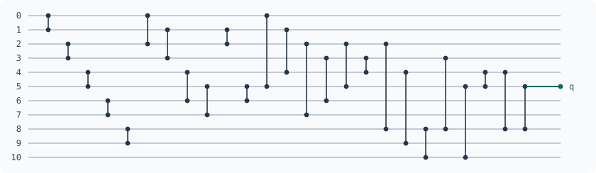

# Optimality of a 25-Comparator Median Selection Network on Eleven Inputs

Exactly **25 comparators** are necessary and sufficient to select the sixth smallest of **11 inputs** on wire 5 (zero-based), with unrestricted depth. The result holds on every decidable total order with at least two distinct values, including inputs with ties.

[Bert Dobbelaere's published construction](https://bertdobbelaere.github.io/median_networks.html#N11L25D11) attains the bound with standard compare-exchanges. The contribution here is the matching lower bound, which allows either comparator orientation and any fixed output wire. Removing an extreme input twice reduces the problem to certified exclusions on nine wires. The full certificate contains **26 exclusions and 174,008 proof nodes**.



| Read or inspect | Location |
| --- | --- |
| Manuscript | [PDF](paper/main.pdf) · [LaTeX](paper/main.tex) |
| Proof | [Overview](docs/proof-overview.md) · [Lean 4 formalization](docs/formal-verification.md) · [`Median11.median11_optimal`](formal/Median11/Optimality.lean#L26) |
| Data | [Witness](median11_25.json) · [Certificate](certificate/) · [Format](docs/certificate-format.md) |
| Review | [One-page summary](review/summary.pdf) · [Reviewer guide](review/README.md) · [Technical validation](docs/validation.md) |

## Reproduce

From the repository root on Linux, run:

```sh
bash scripts/verify.sh
bash scripts/verify-lean.sh
bash scripts/evaluate-lean-archive.sh
```

The first command checks the witness, replays the certificate with standalone Python and C++ implementations, tests damaged inputs and regenerates the certificate. The second builds the kernel proofs in Lean 4.19.0 and audits their axiom dependencies. The third runs the Lean executable replay. See the [reproduction guide](docs/reproducibility.md) for prerequisites, expected output and PDF builds.

## Cite

Cite Rocco Martino, *Optimality of a 25-Comparator Median Selection Network on Eleven Inputs*, artifact version **1.0.3**, with the Git commit used. See [citation metadata](CITATION.cff), [version history](CHANGELOG.md) and [third-party attribution](THIRD-PARTY.md).

Earlier deposits record distinct versions. Use their version-specific DOIs when citing those snapshots. [v1.0.0-rc.1](https://doi.org/10.5281/zenodo.24397284) · [v1.0.0-rc.2](https://doi.org/10.5281/zenodo.24397716).

Development used substantial generative AI assistance. External human peer review and historical priority remain open.
