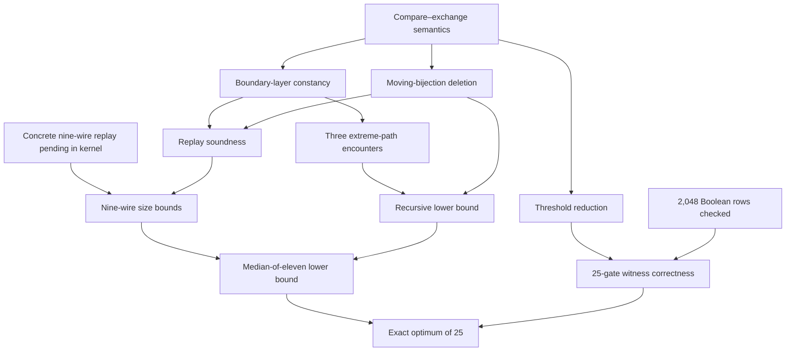

# Formal verification report for 1.0.0-rc.3

## Exact status

Lean 4.19.0 verifies the 25-comparator witness and the lower bound conditional on the two nine-input bounds. The overall result remains computer-assisted. The kernel checks the concrete archive replays at widths two through six, comprising 11 claims. Python, C++ and the executable Lean checker replay the full archive. The complete nine-wire exclusions remain open in the kernel.

### Theorems

| Lean statement | Result |
|---|---|
| `Median11.published_size`, `Median11.published_standard` | The distributed construction has 25 gates, each with its minimum on the lower-numbered wire. |
| `Median11.published_binary`, `Median11.published_selects` | Exhaustive Boolean correctness on wire 5 and sixth-rank selection over any decidable total order. |
| `Median11.verify_replay_sound` | A successfully checked transcript warrants a size lower bound, given sound incidence bounds from smaller widths. |
| `Median11.bound_2_1`, `bound_3_1`, `bound_3_2`, `bound_4_1`, `bound_4_2`, `bound_5_1`, `bound_5_2`, `bound_5_3`, `bound_6_1`, `bound_6_2`, `bound_6_3` | The first 11 distributed claims, including their recursively checked trace caps. |
| `Median11.median11_from_nine` | Assuming `Bound 9 4 19` and `Bound 9 5 19`, at least 25 gates are needed even with oriented gates and arbitrary fixed output. |
| `Median11.standard_lower_from_nine`, `Median11.median11_optimal_from_nine` | The conditional lower bound and exact-size statement in the standard-oriented, fixed-wire model. |



### Model and data bridge

- `Gate n` contains distinct `Fin n` ports. `step` exchanges them exactly when the port destined to hold the minimum contains the larger input. `Network n` is a list with arbitrary repetitions and length. `Standard` restricts the comparator orientation. No depth condition enters the theorem.
- `SelectsBinary net r q` returns one exactly when the number of zeros is less than one-based rank `r`. `RankValue` states the order-statistic characterization with multiplicity. The binary input domain supplies the lower bound for a universally correct comparator network. The upper bound holds for arbitrary decidable total orders, including ties.
- `Layers.initial` enumerates the full Boolean cube and filters the two boundary weights. `separates_images_iff` and `selectsBinary_of_layers` relate the two residual images to the quantified rank predicate.
- `ReplayOp` projects to the same 0–3 opcodes as the gzip payload. The exporter preserves these bytes and attaches a prior node offset and swap list to each reference. Lean verifies each proposed reference via the completed-state table and exact inclusion of renamed images. The included small-width data is regenerated and matched byte for byte before building. The full data is generated directly from the distributed gzip members and the manifest. Lean's theorem concerns the decoded opcode sequence, while the independent C++ checker also validates archive structure.
- `scripts/generate-lean-witness.py --check` ties the Lean literal `published` to the distributed JSON. `verification/tests/compare.py` ties the manuscript figure to the same JSON.

### Rules to inspect

| Rule | Formal entry point |
|---|---|
| Compare–exchange semantics preserve weight and monotonicity | `weight_run`, `run_mono` |
| Boundary constancy on each of the two layers | `boundary_constant` |
| The first reused wire forces an extreme through a third comparison | `three_comparisons` |
| Deletion preserves an interior rank and subtracts the number of encounters | `deletion_simulation`, `deletion_rank`, `deletion_count` |
| Cardinality, path caps and a saturated varying wire | `cardinality_prune`, `path_prune`, `frozen_prune` |
| All useful gates represented, including reverse orientation | `expand_sound` |
| Closed memo states under one common relabelling | `memo_reuse`, `ReplayState.save_valid`, `replay_sound` |

### Trusted foundations

`#print axioms` on the final conditional theorem and replay soundness reports `[propext, Classical.choice, Quot.sound]`. For witness correctness it reports `[propext, Quot.sound]`, and witness length reports `[propext]`. The project uses Lean's standard kernel and core/Std definitions without Mathlib. The successful proofs depend on neither project axioms nor admissions. The concrete small replays and exhaustive upper-bound checks use kernel reduction. A Boolean result from an external runtime is never imported as a proof.

### Remaining concrete obligations

1. Supply the prerequisite bounds at widths seven and eight, or a different checked proof of the necessary incidence caps.
2. Kernel-check `verifyReplay 9 4 18 14 16 data9_4 = true` and `verifyReplay 9 5 18 16 16 data9_5 = true`, or prove both corresponding `Bound` statements through another verified derivation.
3. Apply `median11_optimal_from_nine` to the resulting bounds and audit the unconditional theorem. Check the remaining full archive claims separately if claiming kernel verification of all 26.

The direct reduction of the large fourth-rank replay was killed during the development environment trial. The attempt is reproducible with the commands below. The executable replay completes using the same Lean definitions without supplying a kernel acceptance theorem.

```sh
bash scripts/verify-lean.sh
bash scripts/evaluate-lean-archive.sh
(cd formal && lake env lean Replay9Rank4.lean)
(cd formal && lake env lean Replay9Rank5.lean)
```
